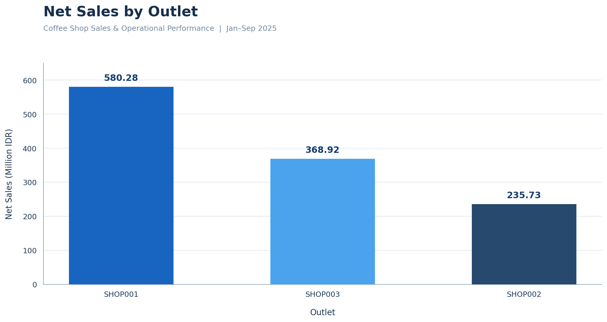
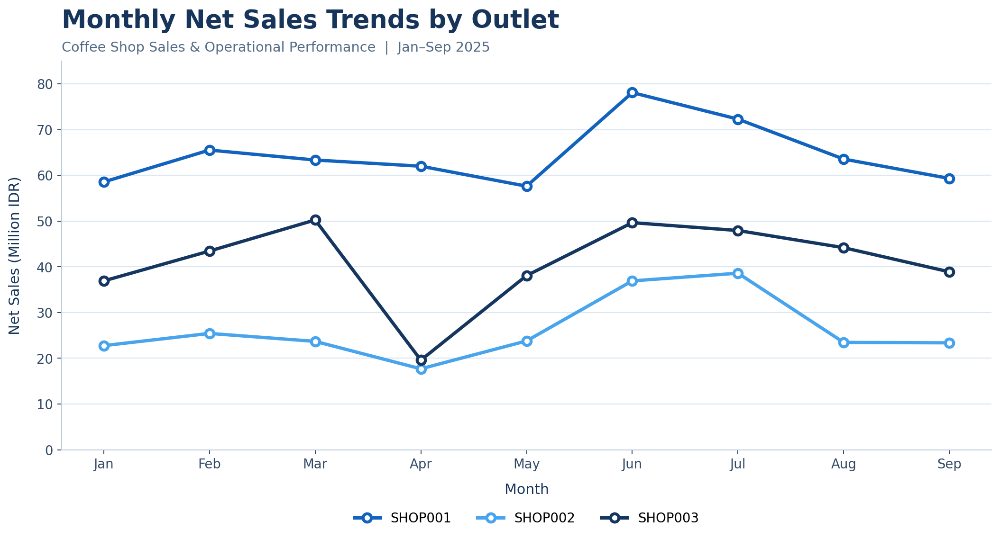
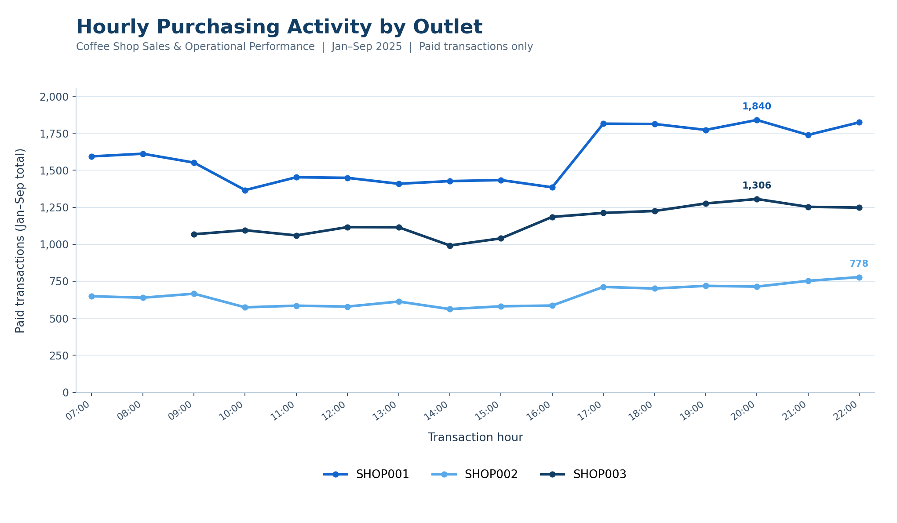

# Coffee Shop Sales & Operational Performance

**SQL Portfolio Project | Indonesia | January–September 2025**

## Project Overview

This project analyzes **53,820 point-of-sale transactions across three outlets** of an Indonesian food-and-beverage business.

The analysis evaluates sales performance, purchasing patterns, and transaction characteristics to identify actionable insights for operational planning and management decision-making.

**Data Source:** [Anonymous Transactional Dataset — Mendeley Data, Version 2](https://data.mendeley.com/datasets/kcgf45y24m/2)

- **Period:** January 2 – September 30, 2025
- **Coverage:** 3 outlets | 53,820 transactions
- **Data used:** Transactions file
- **License:** CC BY 4.0

> **Data availability:** The raw transactions are excluded from this repository and can be obtained from the original Mendeley Data source.

## Tools & SQL Skills

- **PostgreSQL:** Database creation, data validation, and SQL analysis.
- **VS Code + SQLTools:** Query development and execution.
- **SQL techniques:** Aggregations, `GROUP BY`, `FILTER`, `EXTRACT`, `DATE_TRUNC`, CTEs, and window functions (`LAG`).
- **ChatGPT:** AI-assisted visualizations and interpretation, with results reviewed against SQL outputs.

## Business Objectives

**Objective 1 — Evaluate Outlet Sales Performance**

Compare net sales, transaction volumes, average paid transaction values, and monthly sales trends across outlets.

**Objective 2 — Understand Purchasing Patterns**

Examine peak purchasing hours, day-of-week activity, payment methods, and non-paid loyalty transactions.

## Key Findings & Visualizations

### Objective 1 — Outlet Sales Performance

**1. Revenue Performance**

SHOP001 generated the highest net sales (**IDR 580.28M**) and paid transaction volume (25,485). Average paid transaction values were nearly identical across outlets (IDR 22.6K–22.8K), indicating that revenue differences were primarily associated with transaction volume rather than average spending.

**2. Monthly Sales Trends**

SHOP001 consistently led monthly sales. SHOP002 and SHOP003 experienced greater fluctuations, with their largest monthly declines occurring in August (-39.22%) and April (-61.01%), respectively.

### Objective 2 — Purchasing Patterns

**3. Peak Purchasing Hours**

Evening hours (5 PM–10 PM) recorded the highest purchasing activity. SHOP001 and SHOP003 peaked at 8 PM, while SHOP002 peaked at 10 PM.

**4. Day-of-Week Activity**

Average daily paid transaction counts remained relatively consistent across weekdays within each outlet. The range between the highest and lowest weekday averages was approximately **3.3%–9.4%** relative to each outlet's mean weekday average, suggesting limited differences in typical purchasing activity by day of week.

**5. Payment Method Patterns**

BCA accounted for **82.2% of paid transactions**, followed by Cash (17.6%). Average paid transaction values were similar across these payment categories.

**6. Non-Paid Loyalty Transactions**

SHOP002 recorded the highest proportion of non-paid loyalty transactions (3.75%), while SHOP001 recorded the highest absolute number (765). These differences describe transaction patterns, not customer loyalty or retention.

## Management Recommendations

| Area                            | Recommended Action                                                                                                                                                                               |
| ------------------------------- | ------------------------------------------------------------------------------------------------------------------------------------------------------------------------------------------------ |
| **Staffing & Service Capacity** | Review staffing coverage during peak evening hours, particularly around 8 PM for SHOP001 and SHOP003 and 10 PM for SHOP002. Validate against actual service capacity before adjusting schedules. |
| **Daily Operations**            | Maintain a consistent baseline for staffing and inventory where appropriate, while prioritizing hourly demand patterns over major weekday-specific adjustments.                                  |
| **Sales Performance**           | Investigate significant monthly sales declines at SHOP002 and SHOP003, considering promotions, operational changes, and external factors before determining corrective actions.                  |
| **Payment Operations**          | Prioritize the reliability of BCA-related payment processing and maintain alternative payment options, given its dominant share of paid transactions.                                            |
| **Loyalty Program**             | Review non-paid loyalty transactions and program rules across outlets to understand possible redemption activity, related costs, and differences in recording practices.                         |

These recommendations highlight areas for management review. Specific operational changes require additional evidence, such as staffing levels, service capacity, promotions, and customer information.

## Analytical Notes & Limitations

- **Paid transactions:** Average paid transaction value includes only records where `net_sales > 0`.
- **Loyalty transactions:** All 1,733 zero-sales records were associated with loyalty-card usage. Using `net_sales = 0` to identify non-paid loyalty transactions is specific to this dataset.
- **Customer-level analysis:** Customer identifiers and confirmed reward-redemption details are unavailable; retention and loyalty-program effectiveness cannot be measured.
- **Day-of-week analysis:** Uses averages per observed day; consistent weekday averages do not imply stable demand on individual dates.
- **Payment and currency:** BCA likely refers to Bank Central Asia, but the specific payment channel is unknown. IDR is used based on the Indonesian business context; the source's explicit currency definition remains unverified.
